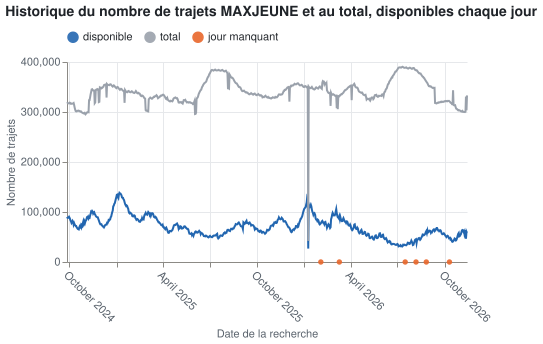
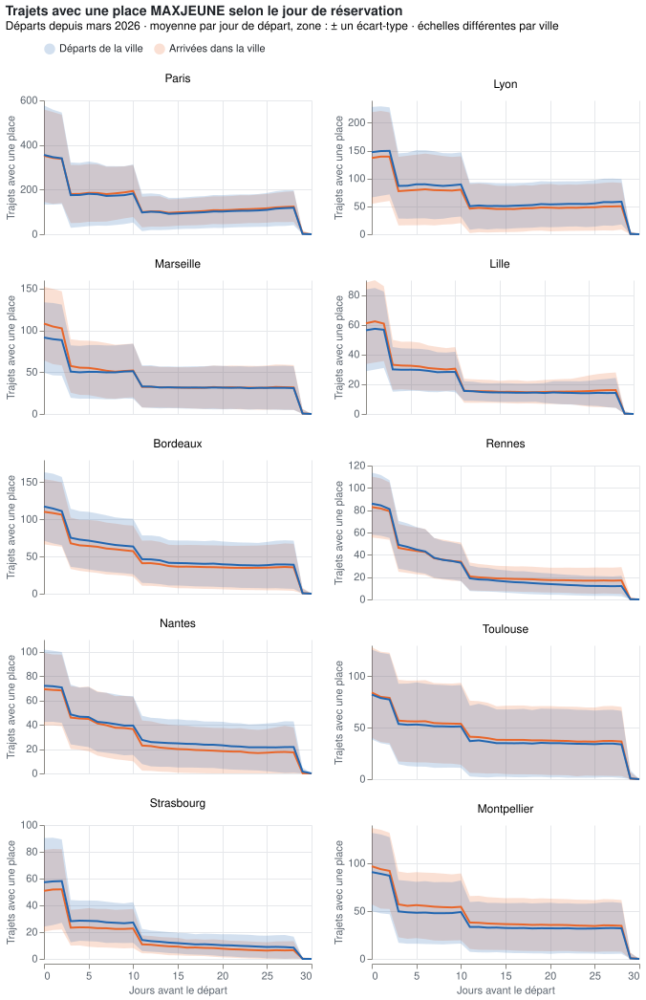
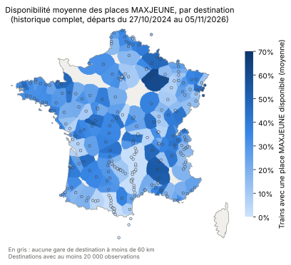
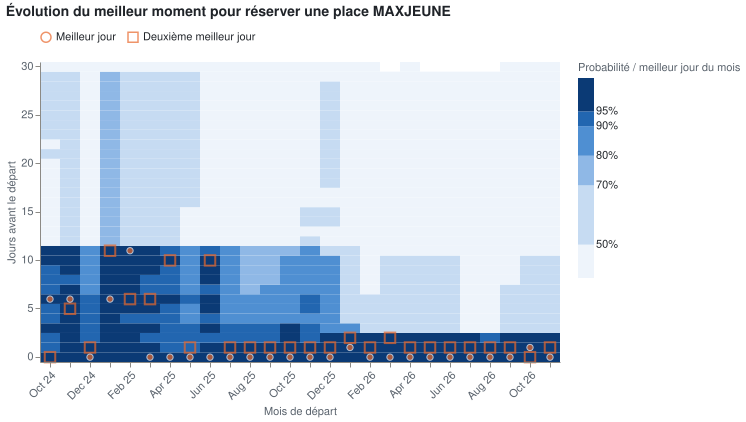

# max-stats

Les disponibilité de places [MAXJEUNE](https://ressources.data.sncf.com/explore/dataset/tgvmax/information/) dans les 30 jours sont 
renouvellées tous les jours par la SNCF MAIS les anciennes données ne sont pas accessibles.
Ce dépot sauvegarde les [données](https://ressources.data.sncf.com/api/explore/v2.1/catalog/datasets/tgvmax/exports/csv) tous les jours à **22h22**.
 
Ce jeu de données archive **<span id="n_requested_days">768</span> jours** de requêtes du **<span id="requests_start">2024-09-26</span>** au **<span id="requests_end">2026-11-08</span>**. Il manque **<span id="n_missing_days">6</span> jours**. 



## Quand réserver ?



Pour chaque trajet (train + origine/destination) et chaque jour de requête, on regarde si une place MAXJEUNE est disponible, 
puis on calcule la proportion de trajets disponibles en fonction du nombre de jours avant le départ (`uv run main.py booking-lead-time`, 
résultats dans `assets/booking_lead_time.csv`). Les trains OUIGO sont exclus : ils sont toujours indiqués sans place MAXJEUNE dans ce jeu de données (nov. 2024 - oct. 2026) et n'y figurent plus depuis mi-octobre 2026, donc les données ne disent rien de leur disponibilité réelle.

Les places ne partent pas : elles sont **libérées par paliers**. Pour les départs depuis mars 2026 :

| Moment de la recherche | Trajets avec une place |
|---|---|
| J-30 (avant l'ouverture) | 0 % |
| J-28 à J-12 | ~12 % |
| J-10 à J-4 | ~21-23 % |
| **J-2 à J-0** | **~40-41 %** |

Les paliers ont lieu dans la journée de J-29 (ouverture), J-11 et, depuis début 2026, J-3. **Le meilleur moment est donc à partir de J-2** 
(le maximum, 41 %, est le jour même). Attendre coûte peu : 89 % des trajets disponibles à J-28 le sont encore à J-2, alors que 26 % des 
trajets indisponibles à J-10 le deviennent à J-2. En 2025, le palier de J-3 n'existait pas (35-36 % de J-11 à J-0).

### Par destination



`booking_lead_time_table` accepte une expression polars `condition` : les probabilités sont alors calculées pour chaque valeur 
de l'expression (par exemple `pl.col("destination_iata")` pour une courbe par destination). `uv run main.py availability-map` 
(après `uv run main.py download-aux`) en déduit la disponibilité moyenne des trains vers chaque destination : la part des 
observations (trajet × jour de requête, de J-30 au jour du départ) avec une place MAXJEUNE (`assets/availability_by_destination.csv`). 
Chaque point de la carte prend la valeur de la gare de destination la plus proche (à moins de 60 km). 
La carte utilise tout l'historique (départs dont les 30 jours de réservation ont été observés) ; `--since-march-2026` la limite aux départs depuis mars 2026.

En moyenne, 24 % des observations ont une place (médiane par destination). Les destinations les plus faciles sont des villes 
moyennes desservies par des trains qui continuent plus loin (Châlons-en-Champagne 62 %, Vitry-le-François 60 %, Bar-le-Duc 59 %, 
Montélimar 54 %, Valence 53 %). Les grandes gares parisiennes sont autour de 15-17 % (Bercy 35 %). Les plus difficiles sont 
l'Ariège (Foix, Ax-les-Thermes : 1 %) et les gares espagnoles (Barcelone, Gérone, Figueres : 0 %).

### Évolution



`uv run main.py best-time-evolution` calcule la courbe pour chaque mois de départ (`assets/best_time_by_month.csv`). La couleur indique la 
probabilité de trouver une place rapportée au meilleur jour du mois, ce qui retire les variations saisonnières. Le carré indique le premier 
jour où l'on atteint 95 % du meilleur jour : le meilleur jour seul est peu fiable quand la courbe est plate.

- **Fin 2024 - début 2025** : la courbe est plate de J-11 à J-0, réserver dès J-11 suffit.
- **Mi-2025 - fin 2025** : le jour même devient nettement meilleur, il faut attendre J-1 ou J-3.
- **Depuis début 2026** : une nouvelle libération de places a lieu à J-3, il faut attendre J-2.

## Format

Les données sont téléchargées au format csv, transformées au format parquet, puis enregistrées dans le dossier `data/maxjeune`.
La description des champs de données est consultable sur la [page](https://ressources.data.sncf.com/explore/dataset/tgvmax/information/) du jeu de données.

Chaque jour les données sont sauvegardées dans le fichier `data/maxjeune/{YYYY-MM-DD}.parquet`, nommé d'après la date (UTC) de la requête.
Si plusieurs requêtes ont lieu le même jour (par exemple quand le téléchargement de la veille est retardé après minuit), les fichiers suivants sont suffixés : `{YYYY-MM-DD}_2.parquet`, etc.

## Réutilisation 
Les données sont produites par la SNCF, la licence est indiquée sur la [page](https://ressources.data.sncf.com/explore/dataset/tgvmax/information/) du jeu de données.
Vous en faites ce que vous voulez.

## Nettoyage
Un certain nombre de trajets concernent des trajets vers l'étranger ou en autocar, d'autres sont mis à jours au cours du mois précédent leur départ et d'autres n'ont tout simplement pas de nom d'origine/destination. Tous ces trajets sont filtrés avec les critères suivants:
```python
pl.col(name) != "TBD",
pl.col(name) != "",
pl.col(axe) != "AUTOCAR SNCF",
pl.col(axe) != "INTERNATIONAL",
``` 

## TODO

- [x] Convertir les anciennes données en format parquet
- [x] Retirer les artefacts de scrapy dans les anciennes données (colonnes "_key" et "_type")
- [x] Ajouter les anciennes données dans le dépot
- [ ] Ajouter un calcul de différences avec le jour précédent dans `download-maxjeune` pour que la CI échoue si on retélécharge les mêmes données
- [x] Automatiquement mettre à jour le readme avec le nombre de jours scrapés et le nombre de jours maquants
- [ ] Automatiquement mettre à jour le readme avec un graphe qui indique le nombre de trajets disponibles dans les 30 prochains jours pour chaque jour de requête (si facile, sous forme de carte animée ?).